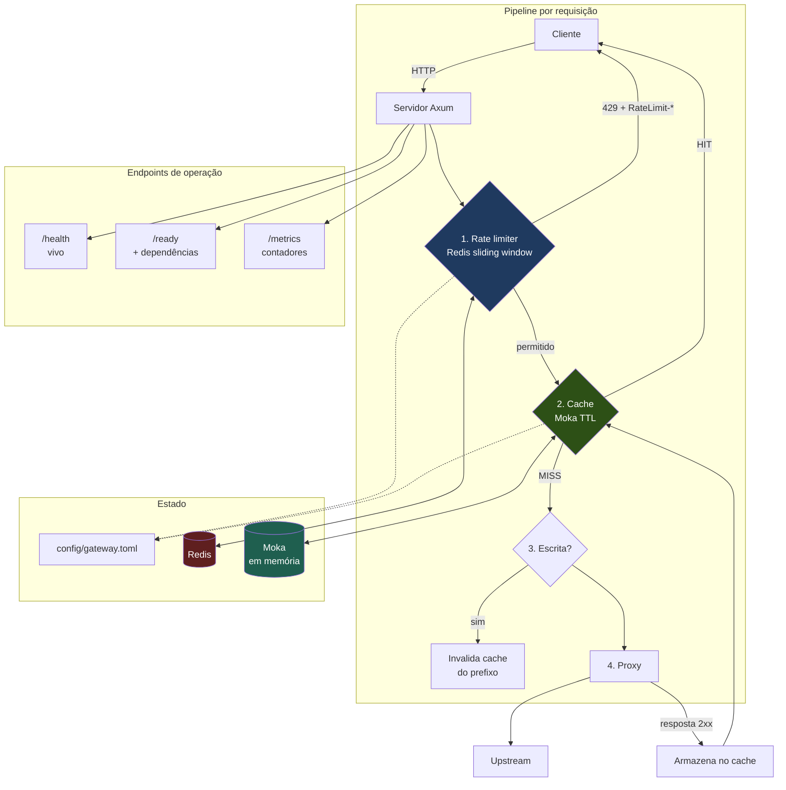
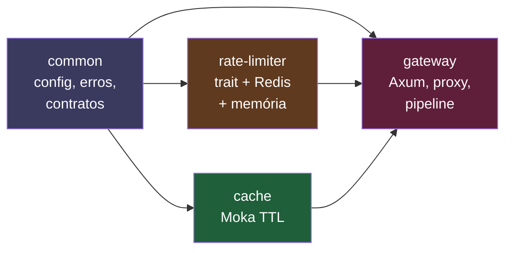
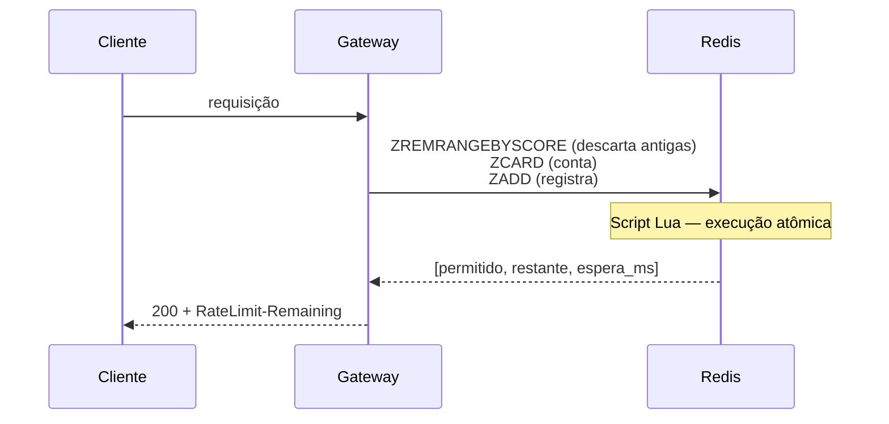

# Rust API Gateway & Rate Limiter

API gateway de alto throughput em Rust: proxy reverso com **rate limiting
distribuído por janela deslizante** (Redis) e **cache de respostas em memória**
(Moka).

Projetado para o caso em que APIs Node/Python degradam sob concorrência: o
gateway absorve tráfego repetido no cache, corta abuso no rate limiter, e só
encaminha ao upstream o que é realmente necessário.

---

## Sumário

- [Arquitetura](#arquitetura)
- [Por que Axum](#por-que-axum)
- [Como o rate limiter funciona](#como-o-rate-limiter-funciona)
- [Decisões de projeto](#decisões-de-projeto)
- [Executando](#executando)
- [Configuração](#configuração)
- [Endpoints](#endpoints)
- [Rate limiting](#rate-limiting)
- [Cache](#cache)
- [Testes](#testes)
- [Benchmark](#benchmark)
- [Docker](#docker)
- [CI](#ci)
- [Limitações conhecidas](#limitações-conhecidas)
- [Licença](#licença)

---

## Arquitetura



### Estrutura do workspace



---

## Por que Axum

A OS pedia Axum **ou** Actix-web. A escolha é Axum, por três razões concretas:

**1. Overhead de alocação por requisição.** Actix-web responde cada requisição
criando um `Actor` por conexão. Numa API gateway lidando com dezenas de milhares
de requisições por segundo, essa alocação por conexão aparece no perfil. Axum
não tem esse custo.

**2. Composição de middleware.** O gateway precisa de camadas bem definidas
(rate limit → cache → proxy). Axum usa `tower`, que é o mesmo ecossistema do
`hyper` — cliente e servidor compartilham os mesmos tipos e middlewares. Com
Actix, cada camada exige um `Transform` próprio, sem reaproveitamento.

**3. Tipos mais honestos.** Actix-web usa `Box<dyn Service>` em boa parte do
caminho, empurrando erros para `Box<dyn Error>` em tempo de execução. Axum é
genérico em runtime, então um handler com assinatura errada não compila. Num
gateway, onde um único header malformado pode derrubar um serviço inteiro, isso
importa.

**Onde Actix venceria:** em benchmark bruto de throughput de CPU. Actix costuma
medir 10–30% mais requisições por núcleo em handlers puramente computacionais.
Como este gateway é dominado por I/O (Redis, cache, rede), essa diferença tende a
ser eclipsada pelo tempo de espera — e o ganho não justifica perder a
composição de middleware.

---

## Como o rate limiter funciona

### Janela deslizante, não janela fixa

A maioria dos rate limiters ingênuos usa janela fixa: um contador que zera no
limite. Isso permite o **dobro** do limite na fronteira — um cliente enche a
janela às 23:59 e enche de novo às 00:00.

A implementação usa **sliding window log**: um sorted set no Redis guarda o
instante de cada requisição. O orçamento é sempre "quantas requisições nos
últimos N milissegundos", sem fronteira para explorar.



### Por que um script Lua

Verificar e registrar precisam ser **atômicos**. Com comandos separados
(`ZCARD` e depois `ZADD`), N requisições concorrentes leem o mesmo `ZCARD`
antes de qualquer uma escrever, e todas passam. O script Lua executa tudo como
uma unidade, sem trava e sem condição de corrida.

### O detalhe que fura limites silenciosamente

`ZADD` com um membro já existente **atualiza** o score em vez de somar. Se o
membro fosse apenas o timestamp em milissegundos, duas requisições no mesmo
milissegundo seriam contadas como uma — e o limite seria furado exatamente nos
picos de tráfego, que é o cenário que o limiter existe para conter.

A solução é `instância + instante + contador`, garantindo unicidade:

```rust
format!("{}-{}-{}", self.instance, now_millis, seq)
```

---

## Decisões de projeto

### Rate limit antes do cache

A ordem parece contraintuitiva: servir do cache não gera tráfego no upstream, então
"não deveria gastar orçamento".

O problema é o efeito prático. Com cache primeiro, um cliente que só lê o mesmo
recurso em loop **nunca é barrado** — o cache absorve tudo. O rate limiter fica
decorativo para o abuso mais comum.

Rate limit primeiro, o orçamento conta todas as requisições (que é o que o
cliente espera de um header `RateLimit-Limit`), e o cache continua economizando
carga do upstream. As duas otimizações continuam funcionando; só a ordem muda.

### `fail_open` explícito

Quando o Redis está fora do ar, há duas escolhas legítimas:

| Configuração | Comportamento | Trade-off |
|---|---|---|
| `fail_open = true` | Libera o tráfego | Disponibilidade. O Redis vira passarela durante a indisponibilidade. |
| `fail_open = false` | Bloqueia o tráfego | Proteção. O próprio gateway se torna o outage. |

Não existe escolha neutra, então está explícita na configuração em vez de
implícita num default.

### `X-Forwarded-For` só com opt-in

`GATEWAY_TRUST_PROXY` precisa estar ligado para que o header seja considerado.
Sem essa trava, qualquer cliente escreveria `X-Forwarded-For: 1.2.3.4` e burlaria
o rate limit, escolhendo o próprio IP a cada requisição.

### Zero `unwrap()` e zero `panic!` em produção

Erros são valores (`Result`, `GatewayError`), nunca pânico. Um gateway em panic
perde todas as requisições em voo; um gateway que devolve 502 ainda as atende.

Os testes usam `expect()` — código de teste pode falhar alto, porque um teste que
ignora erro é pior que nenhum teste.

---

## Executando

### Requisitos

- Rust 1.82+ (edition 2021)
- Redis 7+ (para rate limiting distribuído; opcional em desenvolvimento)
- Docker (opcional, para o ambiente completo)

### Desenvolvimento

```bash
cargo build --release
./target/release/gateway config/gateway.toml
```

```bash
# Verificar se está no ar
curl -s http://127.0.0.1:8080/health | jq
curl -s http://127.0.0.1:8080/ready  | jq

# Exercitar o proxy
curl -si http://127.0.0.1:8080/api/v1/usuarios | head -20
```

### Sem Redis (desenvolvimento)

```toml
[rate_limit]
enabled = false
```

O gateway sobe com o backend em memória. Serve para desenvolvimento e para os
testes — **não** para produção com múltiplas instâncias, porque o orçamento não
seria compartilhado entre processos.

---

## Configuração

Tudo vem de `config/gateway.toml`. Nada de valor fixo no código.

| Chave | Padrão | Descrição |
|---|---|---|
| `server.bind_addr` | `127.0.0.1:8080` | Endereço de escuta |
| `server.shutdown_grace_seconds` | `10` | Prazo para requisições in-flight |
| `upstream.url` | — (obrigatório) | URL base do destino |
| `upstream.timeout_seconds` | `30` | Timeout da requisição |
| `upstream.connect_timeout_seconds` | `5` | Timeout de conexão |
| `rate_limit.enabled` | `false` | Liga o rate limiting |
| `rate_limit.redis_url` | — | Obrigatório se `enabled` |
| `rate_limit.default_limit` | `100` | Requisições por janela |
| `rate_limit.default_window_seconds` | `60` | Tamanho da janela |
| `rate_limit.fail_open` | `true` | Libera ou bloqueia em falha |
| `cache.enabled` | `false` | Liga o cache |
| `cache.max_capacity` | `10000` | Entradas máximas |
| `cache.ttl_seconds` | `30` | TTL das entradas |
| `cache.cacheable_methods` | `["GET","HEAD"]` | Métodos elegíveis |

### Regras por rota

```toml
[[routes]]
path = "/api/v1/login"     # prefixo; vence o mais longo
limit = 5                   # opcional
window_seconds = 60         # opcional
cache = false               # opcional
```

### Variáveis de ambiente

| Variável | Efeito |
|---|---|
| `GATEWAY_CONFIG` | Caminho alternativo da configuração |
| `GATEWAY_LOG_FORMAT=json` | Logs em JSON |
| `GATEWAY_TRUST_PROXY=1` | Considera `X-Forwarded-For` |
| `RUST_LOG` | Filtro de log (`gateway=debug`) |

---

## Endpoints

| Método | Rota | Descrição |
|---|---|---|
| `GET` | `/health` | Vivacidade. **Não** verifica dependências. |
| `GET` | `/ready` | Prontidão. Verifica Redis. 503 se indisponível. |
| `GET` | `/metrics` | Contadores em JSON. |
| `*` | `/*caminho` | Proxy para o upstream. |

### Por que `/health` e `/ready` são diferentes

Confundi-los causa o erro clássico de deploy:

- **`/health`** responde "o processo está vivo?". Um gateway com o Redis fora do
  ar **deve** continuar saudável — está pronto para reconectar, e reiniciá-lo não
  conserta o Redis.
- **`/ready`** responde "pode me mandar tráfego?". Redis fora do ar **deve**
  tirar o gateway de prontidão.

Misturar os dois faz o orquestrador reiniciar o gateway em loop durante uma
indisponibilidade do Redis — derrubando mais serviço do que protegendo.

---

## Rate limiting

### Headers emitidos

| Header | Significado |
|---|---|
| `RateLimit-Limit` | Requisições permitidas na janela |
| `RateLimit-Remaining` | Folga restante |
| `RateLimit-Reset` | Segundos até a próxima liberação |
| `Retry-After` | **Apenas em 429.** Segundos a esperar |

Formato clássico (`RateLimit-Limit` separado), e não o cabeçalho único
`RateLimit` da RFC 9333, porque clientes, SDKs e proxies em produção já
reconhecem o clássico.

### Resposta 429

```json
{
  "error": {
    "code": "rate_limited",
    "message": "limite de requisições excedido"
  }
}
```

`code` é estável e adequado para tratamento programático.

### Identificação do cliente

Por padrão, o IP do socket. Com `GATEWAY_TRUST_PROXY=1`, o primeiro salto do
`X-Forwarded-For` tem precedência — apenas atrás de um proxy que reescreva o
cabeçalho.

---

## Cache

- **Chave:** `MÉTODO /caminho?query`. Método e query fazem parte da chave porque
  `POST /users` e `GET /users` não podem compartilhar entrada, e
  `/busca?q=a` e `/busca?q=b` são buscas diferentes.
- **TTL:** configurável, padrão 30s.
- **Invalidação:** qualquer método não cacheável invalida o prefixo do caminho,
  **antes** de encaminhar. Se o upstream rejeitar a escrita, o cache válido
  continua servindo.
- **Respostas não cacheáveis:** status não-2xx não entram no cache.

Diagnóstico via headers:

```bash
curl -si http://localhost:8080/api/v1/usuarios | grep -i x-cache
# X-Cache: MISS   → veio do upstream
# X-Cache: HIT    → veio do cache
```

---

## Testes

```bash
cargo test --workspace              # 171 testes
cargo test -p gateway --test integration   # pipeline ponta a ponta
```

| Crate | Testes | Foco |
|---|---|---|
| `common` | 34 | Configuração, erros, contratos de rate limit |
| `rate-limiter` | 42 | Janela deslizante, concorrência, unicidade de membro |
| `cache` | 21 | TTL, invalidação, chave, métricas |
| `gateway` (lib) | 33 | Filtro de headers, montagem de URL, decisões |
| `gateway` (main) | 3 | Arranque |
| `gateway` (integração) | 19 | Pipeline completo com upstream real |
| `rate-limiter` (Redis real) | 19 | Sliding window contra Redis em container |

### Cobertura

```bash
cargo install cargo-llvm-cov --locked
rustup component add llvm-tools-preview      # pré-requisito do llvm-cov

cargo llvm-cov --workspace --summary-only
```

**90,12% de linhas** (2.389 linhas, 236 não cobertas). Mínimo exigido: 70%.

| Arquivo | Linhas cobertas | % |
|---|---:|---:|
| `rate-limiter/src/memory.rs` | 220/220 | 100,00% |
| `rate-limiter/src/lua.rs` | 41/41 | 100,00% |
| `rate-limiter/src/clock.rs` | 59/59 | 100,00% |
| `common/src/ratelimit.rs` | 122/122 | 100,00% |
| `gateway/src/state.rs` | 31/31 | 100,00% |
| **`rate-limiter/src/redis_backend.rs`** | **129/131** | **98,47%** |
| `gateway/src/net.rs` | 152/158 | 96,20% |
| `gateway/src/proxy.rs` | 228/242 | 94,21% |
| `common/src/error.rs` | 59/66 | 89,39% |
| `gateway/src/pipeline.rs` | 137/158 | 86,71% |
| `gateway/src/routes.rs` | 68/104 | 65,38% |
| `gateway/src/main.rs` | 16/140 | 11,43% |

`main.rs` aparece baixo porque contém o arranque do binário — carregar
configuração, montar estado, abrir socket, tratar sinais. Nenhum teste executa
`main()`; exercitar isso exigiria subir o processo, e o teste de integração já
faz isso por outro caminho. O número está listado sem ajuste, sem excluir
arquivos da métrica para inflar o total.

**Nota sobre ferramentas de cobertura.** `cargo-tarpaulin` e `cargo-llvm-cov`
divergem no que contam como "arquivo": o tarpaulin omitiu `redis_backend.rs` na
primeira execução desta série, e o llvm-cov conta regiões, funções e linhas
separadamente. Os números desta tabela são do **llvm-cov**, ferramenta indicada
pela OS. A métrica de referência é a coluna **Lines / Cover**.

### Testes contra Redis real (testcontainers)

O rate limiter roda em produção sobre um script Lua executado pelo Redis, com
serialização de argumentos e round-trip de rede. Um mock de Redis não tem nada
disso — ele validaria o Rust chamando o Rust, e passaria mesmo com o Lua
sintaticamente errado, com `ARGV` na ordem errada ou com tipo de retorno
incompatível.

Por isso os testes sobem um **Redis real em container efêmero**:

```bash
cargo test -p gateway-rate-limiter --test redis_backend_teste
```

**19 testes**, todos contra o Redis 7 real:

| Teste | O que prova |
|---|---|
| `membro_repetido_nao_colapsa_o_limite` | O bug histórico: `ZADD` com membro repetido **atualiza** em vez de somar. Relógio congelado, 50 requisições no mesmo milissegundo, `ZCARD` tem de dar 50 |
| `fronteira_de_janela_nao_permite_dobro` | Baseado no instante real da meia-noite (23:59:59 → 00:00:00): a rajada após a fronteira é barrada. Janela fixa deixaria passar o dobro |
| `concorrencia_nao_fura_o_limite_no_redis_real` | 160 requisições concorrentes contra limite 40; exatamente 40 passam. É o teste que valida a atomicidade do script Lua |
| `zadd_e_zremrangebyscore_implementam_a_janela` | `ZCARD` reflete o log de instantes; evento expirado sai via `ZREMRANGEBYSCORE` |
| `ttl_configurado_no_sorted_set` | `PTTL` entre 40s e 45s para janela de 45s — sem isso, chaves de clientes abandonados vazariam memória |
| `limite_atingido_no_ponto_exato` | 7 de 7 passam com folga decrescente; a 8ª é barrada com `Retry-After > 0` |
| `script_nao_deixa_estado_parcial_quando_bloqueia` | Se a poda ocorresse depois da decisão, a chave nunca decairia e o cliente ficaria barrado para sempre |
| `chaves_distintas_nao_compartilham_orcamento` | Chaves independentes não dividem orçamento |
| `prefixos_de_tenant_nao_vazam_entre_si` | Cliente A esgotado não afeta B; rota diferente tem orçamento separado |
| `redis_fora_do_ar_produz_erro_tratado` | Conexão recusada vira `GatewayError::Redis`, nunca pânico |
| `erro_nao_arrasta_informacao_de_rede_para_o_cliente` | A mensagem interna pode citar host e porta; a pública, não |
| `falha_apos_conexao_e_um_erro_tratado` | Redis derrubado após conectar: o `Result` absorve, sem pânico |
| `chave_resetada_some_do_redis` | `DEL` remove a chave e o orçamento volta |
| `health_ping_responde_ok_com_redis_vivo` | `PING` responde |
| `debug_nao_vaza_a_conexao` | `Debug` não expõe a URL (ela carrega credencial) |
| `kind_identifica_o_backend_como_redis` | `kind()` == `"redis"` |

Cada teste usa prefixo de chave único, em vez de `FLUSHDB`: num container
compartilhado com testes paralelos, `FLUSHDB` criaria interferência — e testar
isolamento por prefixo já valida o requisito.

O relógio é `ManualClock`, não o do sistema: testar janela deslizante com
tempo real significaria dormir um segundo por caso, deixando a suíte lenta e
flaky. O Redis continua real; só o relógio é controlado.

### O que os testes de integração provam

O upstream de teste é um servidor axum real em porta efêmera, não um mock de
cliente HTTP — o que se quer verificar é a integração entre as duas pontas,
incluindo encaminhamento de headers e status de volta.

- `rate_limiter_devolve_429_com_headers` — 429 real com headers
- `requisicao_barrada_nao_chega_ao_upstream` — o barrado não gera tráfego
- `cache_serve_segunda_leitura_sem_bater_no_upstream` — HIT sem ida ao upstream
- `escrita_invalida_o_cache` — POST limpa o prefixo
- `cabecalhos_hop_by_hop_nao_chegam_ao_upstream` — `Connection`, `Transfer-Encoding`
- `requisicoes_concorrentes_respeitam_o_limite` — 60 concorrentes, exatamente o limite passa
- `upstream_inacessivel_devolve_502` — degradação sem panic

---

## Benchmark

```bash
cargo bench --bench throughput
```

Resultados medidos nesta máquina (GTX 1050 Ti, 12 threads):

| Benchmark | Tempo | Throughput |
|---|---|---|
| `rate_limiter/janela_60s_limite_1000` | 850 ns | ~1,17 M ops/s |
| `rate_limiter/janela_60s_limite_10` | 591 ns | ~1,69 M ops/s |
| `cache/get_hit` | 560 ns | ~1,79 M ops/s |
| `cache/get_miss` | 471 ns | ~2,12 M ops/s |
| `cache/insert` | 2,28 µs | ~439 K ops/s |
| `cache/montagem_de_chave` | 174 ns | — |
| `pipeline/identidade_de_cliente` | 91 ns | — |

**Leitura honesta:** estes são microbenchmarks de estrutura de dados, não do
gateway completo. Medem o custo das operações isoladas, não o caminho com rede.
O benchmark end-to-end fica para a Fase 6, com `oha` ou `wrk` contra o contêiner.

O número relevante: a camada de rate limiting em memória custa ~850 ns por
operação. Mesmo no pior caso (o limite já esgotado), isso é quatro ordens de
magnitude abaixo do tempo de rede — o limiter não é o gargalo, e é por isso que
fazer Redis no caminho crítico não prejudica o throughput.

---

## Docker

### Imagem multi-stage

```bash
docker build --target runtime -t rust-api-gateway .
```

A imagem final não tem toolchain nem código-fonte. Não é estética: uma imagem de
runtime com sources expõe exatamente o que o contêiner deveria proteger. O
usuário não é root.

### Ambiente completo

```bash
docker compose up --build
```

Sobe três serviços: `gateway`, `redis` e `upstream-fake`. O upstream falso
existe porque sem ele qualquer teste do caminho de proxy seria contra vácuo.

```bash
curl -s http://127.0.0.1:8080/ready | jq
curl -si http://127.0.0.1:8080/api/v1/login | grep -i ratelimit
docker compose down -v
```

---

## CI

`.github/workflows/ci.yml` — quatro jobs:

| Job | O que faz |
|---|---|
| `qualidade` | fmt, clippy `-D warnings`, testes, build release |
| `cobertura` | tarpaulin com `--fail-under-lines 70` |
| `docker` | build da imagem e verificação de `/health` |
| `compose` | `docker compose up` e verificação de rate limit real |

---

## Limitações conhecidas

**Rate limiter em memória não é compartilhado.** Com `rate_limit.enabled = false`
e múltiplas instâncias, cada uma dá orçamento dobrado. Em produção, Redis é
obrigatório.

**Invalidação do cache é por varredura.** Não há remoção nativa por padrão de
chave no Moka, então `invalidate_prefix` percorre as entradas. É aceitável
porque invalidações são raras em leitura, mas o custo cresce com o número de
entradas — não com o tráfego.

**Sem rate limit por chave de API.** Só por IP + rota. Roteamento por
`X-Api-Key` é o próximo passo natural.

**Cache não negocia `Cache-Control`.** Uma resposta com `no-store` ainda é
cacheada. Um proxy que respeita a diretiva do cliente teria que ser implementado.

**Métricas em JSON, não Prometheus.** Legível por humano e por `curl`. Trocar
requer um parser no coletor.

**Sem TLS.** Terminação fica a cargo do proxy ou do load balancer à frente.

**Membro único por instância + contador.** Correto para até 2⁶⁴ requisições por
instância por milissegundo. Suficiente para qualquer caso real, mas não é
infinito.

---

## Licença

MIT