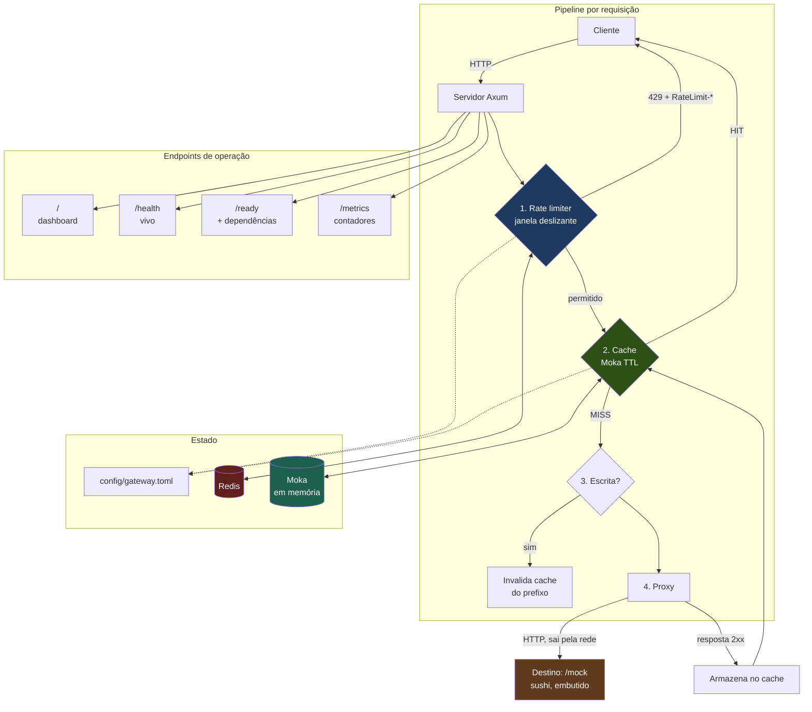
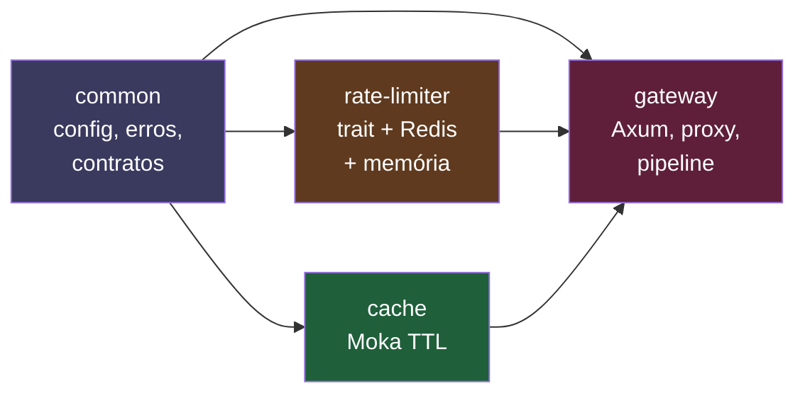
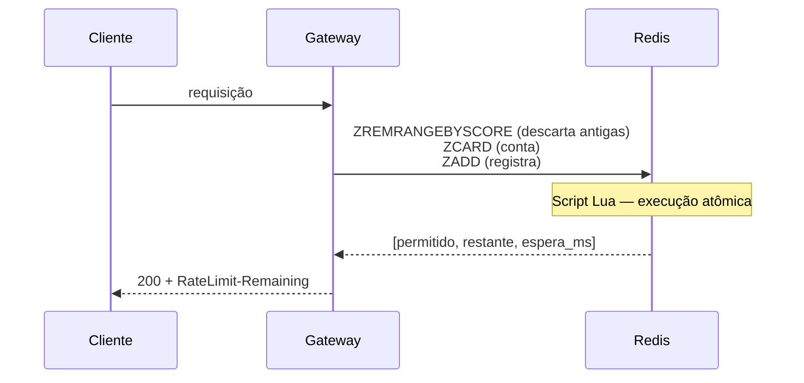

# Sushi Tech Gateway

**O Maître da sua operação.**

API gateway de alto throughput em Rust: proxy reverso com **rate limiting por
janela deslizante** (Redis ou em memória) e **cache de respostas em memória**
(Moka).

Projetado para o caso em que APIs Node/Python degradam sob concorrência: o
gateway absorve tráfego repetido no cache, corta abuso no rate limiter, e só
encaminha ao destino o que é realmente necessário.

Este repositório é a **demonstração Sushi Tech**. Um restaurante de sushi é o
sistema protegido, e o gateway é o maître: conta quantas vezes cada mesa pediu,
guarda o que já está pronto e barra quem insiste além da conta — antes que a
cozinha fique sabendo. A demonstração é autocontida: o restaurante simulado
mora **dentro do próprio binário**, sob `/mock`, então um comando sobe tudo.

```bash
docker compose up --build
# abra http://127.0.0.1:8080
```

---

## Sumário

- [Arquitetura](#arquitetura)
- [A demonstração Sushi Tech](#a-demonstração-sushi-tech)
- [Por que Axum](#por-que-axum)
- [Como o rate limiter funciona](#como-o-rate-limiter-funciona)
- [Decisões de projeto](#decisões-de-projeto)
- [Executando](#executando)
- [Configuração](#configuração)
- [Endpoints](#endpoints)
- [Rate limiting](#rate-limiting)
- [Cache](#cache)
- [Testes](#testes)
- [Benchmark](#benchmark)
- [Docker](#docker)
- [CI](#ci)
- [Limitações conhecidas](#limitações-conhecidas)
- [Licença](#licença)

---

## Arquitetura



O destino é o próprio gateway, sob `/mock`. Não é um mock de teste: é um
servidor HTTP de verdade, alcançado por TCP como qualquer outro — o proxy
atravessa filtragem de cabeçalhos hop-by-hop, timeout, streaming de corpo. O
que ele **não** exercita é o que pertence ao ambiente de produção e não ao
simulador: TLS de saída, autenticação mútua e DNS de um host real.

A alternativa — um segundo contêiner só para o destino — foi descartada porque
custaria a propriedade mais importante deste repositório: clonar e ver
funcionando com um comando. Em produção, `[mock] enabled = false` desliga as
rotas e `upstream.url` recebe o sistema real.

### Estrutura do workspace



---

## A demonstração Sushi Tech

Abra `http://127.0.0.1:8080`. Não é uma página de exemplo: é o painel do maître,
servido pelo próprio gateway.

### Os três botões

| Botão | Rota | O que demonstra |
|---|---|---|
| **Ver Cardápio** | `GET /api/cardapio` | Clique duas vezes seguidas: a segunda resposta vem do cache e o painel avisa **"Resposta veio do Cache! (Muito rápido!)"**. O tempo cai de ~500 ms para menos de 1 ms, e o contador de idas à cozinha para de subir |
| **Simular Ataque** | 10 requisições simultâneas a `/api/cardapio` | O maître conta por mesa e por rota. A barra de orçamento esvazia e o excedente volta `429` — a cozinha nunca fica sabendo |
| **Fazer Pedido** | `POST /api/pedido` | Escrita não é cacheada, e o maître invalida o que guardou para aquele caminho |

### A ordem importa: rate limit antes do cache

Se o cache viesse primeiro, um cliente que apenas relê o mesmo recurso em laço
nunca consumiria orçamento — e o limitador seria decorativo exatamente contra o
abuso mais comum, que é a releitura. Com a ordem atual, toda requisição conta,
venha ela do cache ou não. É também o que faz o botão de ataque funcionar mesmo
depois de o cardápio já estar em cache.

### Os números, e por que são baixos

Vêm de `config/gateway.toml`. São deliberadamente apertados para que o efeito
caiba na tela:

| Parâmetro | Valor | Por quê |
|---|---|---|
| `/api/cardapio` | 8 req / 60 s | O botão de ataque dispara 10; com 8, a barreira aparece |
| `/api/pedido` | 30 req / 60 s | Escrita legítima não deve ser barrada |
| `cache.ttl_seconds` | 30 | Janela confortável para clicar duas vezes |
| `mock.delay_ms` | 500 | Sem atraso, "veio do cache" não é mensurável |

**Oito leituras de cardápio por minuto seriam punitivas num restaurante real.**
O valor está assim para que a demonstração seja visível, e está escrito no
próprio arquivo de configuração para que ninguém confunda demonstração com
recomendação.

### O navegador não pode esconder o servidor

O painel chama todas as rotas com `cache: "no-store"`. Sem isso, o cache do
**navegador** responderia antes do gateway, e o `X-Cache: HIT` seria do browser
— a demonstração passaria a medir a coisa errada.

---

## Por que Axum

A OS pedia Axum **ou** Actix-web. A escolha é Axum, por três razões concretas:

**1. Overhead de alocação por requisição.** Actix-web responde cada requisição
criando um `Actor` por conexão. Numa API gateway lidando com dezenas de milhares
de requisições por segundo, essa alocação por conexão aparece no perfil. Axum
não tem esse custo.

**2. Composição de middleware.** O gateway precisa de camadas bem definidas
(rate limit → cache → proxy). Axum usa `tower`, que é o mesmo ecossistema do
`hyper` — cliente e servidor compartilham os mesmos tipos e middlewares. Com
Actix, cada camada exige um `Transform` próprio, sem reaproveitamento.

**3. Tipos mais honestos.** Actix-web usa `Box<dyn Service>` em boa parte do
caminho, empurrando erros para `Box<dyn Error>` em tempo de execução. Axum é
genérico em runtime, então um handler com assinatura errada não compila. Num
gateway, onde um único header malformado pode derrubar um serviço inteiro, isso
importa.

**Onde Actix venceria:** em benchmark bruto de throughput de CPU. Actix costuma
medir 10–30% mais requisições por núcleo em handlers puramente computacionais.
Como este gateway é dominado por I/O (Redis, cache, rede), essa diferença tende a
ser eclipsada pelo tempo de espera — e o ganho não justifica perder a
composição de middleware.

---

## Como o rate limiter funciona

### Janela deslizante, não janela fixa

A maioria dos rate limiters ingênuos usa janela fixa: um contador que zera no
limite. Isso permite o **dobro** do limite na fronteira — um cliente enche a
janela às 23:59 e enche de novo às 00:00.

A implementação usa **sliding window log**: um sorted set no Redis guarda o
instante de cada requisição. O orçamento é sempre "quantas requisições nos
últimos N milissegundos", sem fronteira para explorar.



### Por que um script Lua

Verificar e registrar precisam ser **atômicos**. Com comandos separados
(`ZCARD` e depois `ZADD`), N requisições concorrentes leem o mesmo `ZCARD`
antes de qualquer uma escrever, e todas passam. O script Lua executa tudo como
uma unidade, sem trava e sem condição de corrida.

### O detalhe que fura limites silenciosamente

`ZADD` com um membro já existente **atualiza** o score em vez de somar. Se o
membro fosse apenas o timestamp em milissegundos, duas requisições no mesmo
milissegundo seriam contadas como uma — e o limite seria furado exatamente nos
picos de tráfego, que é o cenário que o limiter existe para conter.

A solução é `instância + instante + contador`, garantindo unicidade:

```rust
format!("{}-{}-{}", self.instance, now_millis, seq)
```

---

## Decisões de projeto

### Rate limit antes do cache

A ordem parece contraintuitiva: servir do cache não gera tráfego no upstream, então
"não deveria gastar orçamento".

O problema é o efeito prático. Com cache primeiro, um cliente que só lê o mesmo
recurso em loop **nunca é barrado** — o cache absorve tudo. O rate limiter fica
decorativo para o abuso mais comum.

Rate limit primeiro, o orçamento conta todas as requisições (que é o que o
cliente espera de um header `RateLimit-Limit`), e o cache continua economizando
carga do upstream. As duas otimizações continuam funcionando; só a ordem muda.

### `fail_open` explícito

Quando o Redis está fora do ar, há duas escolhas legítimas:

| Configuração | Comportamento | Trade-off |
|---|---|---|
| `fail_open = true` | Libera o tráfego | Disponibilidade. O Redis vira passarela durante a indisponibilidade. |
| `fail_open = false` | Bloqueia o tráfego | Proteção. O próprio gateway se torna o outage. |

Não existe escolha neutra, então está explícita na configuração em vez de
implícita num default.

### Cabeçalho de IP só com opt-in

`GATEWAY_TRUST_PROXY` precisa estar ligado para que qualquer cabeçalho de IP
seja considerado. Sem essa trava, qualquer cliente escreveria
`X-Forwarded-For: 1.2.3.4` (ou `CF-Connecting-IP: 1.2.3.4`) e burlaria o rate
limit, escolhendo o próprio IP a cada requisição.

Com a trava ligada, a ordem é `CF-Connecting-IP` → `X-Forwarded-For` →
`X-Real-IP` → IP da conexão. O `CF-Connecting-IP` vem primeiro porque a borda da
Cloudflare o **reescreve** — o cliente não consegue escolhê-lo, ao contrário de
um `X-Forwarded-For` que ele pode prefixar.

### Zero `unwrap()` e zero `panic!` em produção

Erros são valores (`Result`, `GatewayError`), nunca pânico. Um gateway em panic
perde todas as requisições em voo; um gateway que devolve 502 ainda as atende.

Os testes usam `expect()` — código de teste pode falhar alto, porque um teste que
ignora erro é pior que nenhum teste.

---

## Executando

### Requisitos

- Docker + Compose — o caminho recomendado
- Rust 1.82+ (edition 2021) — apenas para rodar fora de contêiner
- Redis 7+ — opcional: sem ele, use `rate_limit.backend = "memory"`

### O caminho curto

```bash
docker compose up --build
# painel do maître em http://127.0.0.1:8080
```

Dois serviços: o `gateway` e o `redis`. O restaurante simulado está embutido no
binário do gateway, então não há um terceiro contêiner para subir antes.

### Sem contêiner

```bash
cargo build --release
./target/release/gateway config/gateway.toml
```

```bash
# A demonstração inteira responde sem serviço externo
curl -s  http://127.0.0.1:8080/health
curl -si http://127.0.0.1:8080/api/cardapio | grep -i x-cache   # MISS
curl -si http://127.0.0.1:8080/api/cardapio | grep -i x-cache   # HIT
```

### Sem Redis

```toml
[rate_limit]
enabled = true
backend = "memory"
```

O orçamento passa a valer por processo. É suficiente para desenvolvimento, para
a demonstração e para implantação de instância única — **não** para produção com
múltiplas instâncias: com `N` processos, o limite efetivo é `N × limit`, porque
cada um conta sozinho. É por isso que a escolha do backend é explícita na
configuração, e não inferida da presença do Redis: a diferença entre "limita" e
"limita por instância" não pode ser um detalhe silencioso.

---

## Configuração

Tudo vem de `config/gateway.toml`. Nada de valor fixo no código.

| Chave | Padrão | Descrição |
|---|---|---|
| `server.bind_addr` | `127.0.0.1:8080` | Endereço de escuta |
| `server.shutdown_grace_seconds` | `10` | Prazo para requisições in-flight |
| `upstream.url` | — (obrigatório) | URL base do destino |
| `upstream.timeout_seconds` | `30` | Timeout da requisição |
| `upstream.connect_timeout_seconds` | `5` | Timeout de conexão |
| `rate_limit.enabled` | `false` | Liga o rate limiting |
| `rate_limit.backend` | `"redis"` | `"redis"` (compartilhado) ou `"memory"` (por processo) |
| `rate_limit.redis_url` | — | Obrigatório se `backend = "redis"` e `enabled` |
| `rate_limit.default_limit` | `100` | Requisições por janela |
| `rate_limit.default_window_seconds` | `60` | Tamanho da janela |
| `rate_limit.fail_open` | `true` | Libera ou bloqueia em falha do backend |
| `cache.enabled` | `false` | Liga o cache |
| `cache.max_capacity` | `10000` | Entradas máximas |
| `cache.ttl_seconds` | `30` | TTL das entradas |
| `cache.cacheable_methods` | `["GET","HEAD"]` | Métodos elegíveis |
| `mock.enabled` | `true` | Liga o destino simulado sob `/mock/*` |
| `mock.delay_ms` | `500` | Atraso que simula o preparo |

### Regras por rota

```toml
[[routes]]
path = "/api/cardapio"      # prefixo; vence o mais longo
limit = 8                   # opcional
window_seconds = 60         # opcional
cache = false               # opcional
```

### Variáveis de ambiente

| Variável | Efeito |
|---|---|
| `PORT` | Porta de escuta; precede `server.bind_addr`. O destino embutido é realinhado junto |
| `GATEWAY_CONFIG` | Caminho alternativo da configuração |
| `GATEWAY_LOG_FORMAT=json` | Logs em JSON |
| `GATEWAY_TRUST_PROXY=1` | Considera `CF-Connecting-IP`, `X-Forwarded-For` e `X-Real-IP` |
| `RUST_LOG` | Filtro de log (`gateway=debug`) |

---

## Endpoints

| Método | Rota | Descrição |
|---|---|---|
| `GET` | `/` | Painel do maître (dashboard da demonstração). |
| `GET` | `/health` | Vivacidade. **Não** verifica dependências. |
| `GET` | `/ready` | Prontidão. Verifica o backend do rate limiter. 503 se indisponível. |
| `GET` | `/metrics` | Contadores em JSON. |
| `GET` | `/mock/health` | Saúde do destino simulado. |
| `GET` | `/mock/api/cardapio` | Cardápio, com o atraso de `mock.delay_ms`. |
| `POST` | `/mock/api/pedido` | Registra um pedido no destino simulado. |
| `*` | `/*caminho` | Proxy para o destino, sob `/mock`. |

As rotas `/mock/*` são registradas **antes** do curinga, e a ordem não é
estética. Como o proxy aponta para o próprio gateway, um `/mock/*` que caísse no
curinga seria encaminhado para si mesmo — e cada volta acrescentaria outro
`/mock` ao caminho. Não é hipótese remota: `GET /qualquer-coisa`, que o proxy
reescreve para `/mock/qualquer-coisa`, bastaria. É por isso que existe uma rota
`/mock/{*resto}` fechando o prefixo inteiro. Há um teste dedicado a isso
(`caminho_desconhecido_nao_entra_em_recursao`), porque o modo de falha não é um
erro: é o processo inteiro consumido por requisições que se chamam sem fim.

Em produção, `[mock] enabled = false` remove todas as rotas `/mock/*`.

### Por que `/health` e `/ready` são diferentes

Confundi-los causa o erro clássico de deploy:

- **`/health`** responde "o processo está vivo?". Um gateway com o Redis fora do
  ar **deve** continuar saudável — está pronto para reconectar, e reiniciá-lo não
  conserta o Redis.
- **`/ready`** responde "pode me mandar tráfego?". Redis fora do ar **deve**
  tirar o gateway de prontidão.

Misturar os dois faz o orquestrador reiniciar o gateway em loop durante uma
indisponibilidade do Redis — derrubando mais serviço do que protegendo.

---

## Rate limiting

### Headers emitidos

| Header | Significado |
|---|---|
| `RateLimit-Limit` | Requisições permitidas na janela |
| `RateLimit-Remaining` | Folga restante |
| `RateLimit-Reset` | Segundos até a próxima liberação |
| `Retry-After` | **Apenas em 429.** Segundos a esperar |

Formato clássico (`RateLimit-Limit` separado), e não o cabeçalho único
`RateLimit` da RFC 9333, porque clientes, SDKs e proxies em produção já
reconhecem o clássico.

### Resposta 429

```json
{
  "error": {
    "code": "rate_limited",
    "message": "limite de requisições excedido"
  }
}
```

`code` é estável e adequado para tratamento programático.

### Identificação do cliente

Por padrão, o IP do socket e nenhum cabeçalho. Com `GATEWAY_TRUST_PROXY=1`, a
ordem passa a ser `CF-Connecting-IP` → `X-Forwarded-For` (primeiro salto) →
`X-Real-IP` → socket — sempre atrás de um proxy que reescreva esses cabeçalhos.
O porquê da ordem e o risco do cabeçalho forjado estão em
[Deploy no Render](#deploy-no-render).

---

## Cache

- **Chave:** `MÉTODO /caminho?query`. Método e query fazem parte da chave porque
  `POST /users` e `GET /users` não podem compartilhar entrada, e
  `/busca?q=a` e `/busca?q=b` são buscas diferentes.
- **TTL:** configurável, padrão 30s.
- **Invalidação:** qualquer método não cacheável invalida o prefixo do caminho,
  **antes** de encaminhar. Se o upstream rejeitar a escrita, o cache válido
  continua servindo.
- **Respostas não cacheáveis:** status não-2xx não entram no cache.

Diagnóstico via headers:

```bash
curl -si http://localhost:8080/api/cardapio | grep -i x-cache
# X-Cache: MISS   → o maître foi até a cozinha
# X-Cache: HIT    → o maître serviu da memória
```

---

## Testes

```bash
cargo test --workspace                     # 213 testes
cargo test -p gateway --test sushi         # a demonstração Sushi Tech
cargo test -p gateway --test integration   # pipeline ponta a ponta
```

Os testes do `rate-limiter` sobem um Redis real em container (testcontainers):
**a suíte exige Docker**. Sem Docker eles falham — de propósito, em vez de
serem pulados em silêncio (ver [Testes contra Redis real](#testes-contra-redis-real-testcontainers)).

| Crate | Testes | Foco |
|---|---|---|
| `common` | 39 | Configuração (incluindo `mock` e `backend`), erros, contratos |
| `rate-limiter` | 42 | Janela deslizante, concorrência, unicidade de membro |
| `cache` | 21 | TTL, invalidação, chave, métricas |
| `gateway` (lib) | 48 | Identificação do cliente, filtro de headers, montagem de URL |
| `gateway` (main) | 10 | Arranque e resolução do endereço de escuta |
| `gateway` (integração) | 21 | Pipeline completo com destino real |
| `gateway` (sushi) | 13 | Autoproxy, cache, limite e recursão da demonstração |
| `rate-limiter` (Redis real) | 19 | Janela deslizante contra Redis em container |

### Cobertura

```bash
cargo install cargo-llvm-cov --locked
rustup component add llvm-tools-preview      # pré-requisito do llvm-cov

cargo llvm-cov --workspace --summary-only
```

**91,29% de linhas** (2.699 linhas, 235 não cobertas). Mínimo exigido: 70%.

| Arquivo | Linhas cobertas | % |
|---|---:|---:|
| `rate-limiter/src/memory.rs` | 220/220 | 100,00% |
| `rate-limiter/src/lua.rs` | 41/41 | 100,00% |
| `rate-limiter/src/clock.rs` | 59/59 | 100,00% |
| `common/src/ratelimit.rs` | 122/122 | 100,00% |
| `gateway/src/state.rs` | 31/31 | 100,00% |
| `gateway/src/lib.rs` | 74/74 | 100,00% |
| `cache/src/lib.rs` | 367/370 | 99,19% |
| `gateway/src/mock.rs` | 105/106 | 99,06% |
| `rate-limiter/src/lib.rs` | 171/173 | 98,84% |
| **`rate-limiter/src/redis_backend.rs`** | **129/131** | **98,47%** |
| `gateway/src/net.rs` | 203/207 | 98,07% |
| `gateway/src/dashboard.rs` | 23/24 | 95,83% |
| `common/src/config.rs` | 345/363 | 95,04% |
| `gateway/src/proxy.rs` | 228/242 | 94,21% |
| `common/src/error.rs` | 59/66 | 89,39% |
| `gateway/src/pipeline.rs` | 137/158 | 86,71% |
| `gateway/src/routes.rs` | 68/90 | 75,56% |
| `gateway/src/main.rs` | 82/222 | 36,94% |

`main.rs` continua sendo o menor número, por um motivo estrutural: nenhum teste
executa `main()`. Subir o processo inteiro dentro de um teste é o que os testes
de integração já fazem por outro caminho. O que dá para testar sem isso —
`porta_efetiva`, `eh_destino_local`, `alinhar_destino_embutido` — está testado, e
responde por 36,94% do arquivo; o resto é arranque. O número está listado sem
ajuste, e nenhum arquivo foi excluído da métrica para inflar o total.

**Nota sobre ferramentas de cobertura.** `cargo-tarpaulin` e `cargo-llvm-cov`
divergem no que contam como "arquivo": o tarpaulin omitiu `redis_backend.rs` na
primeira execução desta série, e o llvm-cov conta regiões, funções e linhas
separadamente. Os números desta tabela são do **llvm-cov**, ferramenta indicada
pela OS. A métrica de referência é a coluna **Lines / Cover**.

### Testes contra Redis real (testcontainers)

O rate limiter roda em produção sobre um script Lua executado pelo Redis, com
serialização de argumentos e round-trip de rede. Um mock de Redis não tem nada
disso — ele validaria o Rust chamando o Rust, e passaria mesmo com o Lua
sintaticamente errado, com `ARGV` na ordem errada ou com tipo de retorno
incompatível.

Por isso os testes sobem um **Redis real em container efêmero**:

```bash
cargo test -p gateway-rate-limiter --test redis_backend_teste
```

**19 testes**, todos contra o Redis 7 real:

| Teste | O que prova |
|---|---|
| `membro_repetido_nao_colapsa_o_limite` | O bug histórico: `ZADD` com membro repetido **atualiza** em vez de somar. Relógio congelado, 50 requisições no mesmo milissegundo, `ZCARD` tem de dar 50 |
| `fronteira_de_janela_nao_permite_dobro` | Baseado no instante real da meia-noite (23:59:59 → 00:00:00): a rajada após a fronteira é barrada. Janela fixa deixaria passar o dobro |
| `concorrencia_nao_fura_o_limite_no_redis_real` | 160 requisições concorrentes contra limite 40; exatamente 40 passam. É o teste que valida a atomicidade do script Lua |
| `zadd_e_zremrangebyscore_implementam_a_janela` | `ZCARD` reflete o log de instantes; evento expirado sai via `ZREMRANGEBYSCORE` |
| `ttl_configurado_no_sorted_set` | `PTTL` entre 40s e 45s para janela de 45s — sem isso, chaves de clientes abandonados vazariam memória |
| `limite_atingido_no_ponto_exato` | 7 de 7 passam com folga decrescente; a 8ª é barrada com `Retry-After > 0` |
| `script_nao_deixa_estado_parcial_quando_bloqueia` | Se a poda ocorresse depois da decisão, a chave nunca decairia e o cliente ficaria barrado para sempre |
| `chaves_distintas_nao_compartilham_orcamento` | Chaves independentes não dividem orçamento |
| `prefixos_de_tenant_nao_vazam_entre_si` | Cliente A esgotado não afeta B; rota diferente tem orçamento separado |
| `redis_fora_do_ar_produz_erro_tratado` | Conexão recusada vira `GatewayError::Redis`, nunca pânico |
| `erro_nao_arrasta_informacao_de_rede_para_o_cliente` | A mensagem interna pode citar host e porta; a pública, não |
| `falha_apos_conexao_e_um_erro_tratado` | Redis derrubado após conectar: o `Result` absorve, sem pânico |
| `chave_resetada_some_do_redis` | `DEL` remove a chave e o orçamento volta |
| `health_ping_responde_ok_com_redis_vivo` | `PING` responde |
| `debug_nao_vaza_a_conexao` | `Debug` não expõe a URL (ela carrega credencial) |
| `kind_identifica_o_backend_como_redis` | `kind()` == `"redis"` |

Cada teste usa prefixo de chave único, em vez de `FLUSHDB`: num container
compartilhado com testes paralelos, `FLUSHDB` criaria interferência — e testar
isolamento por prefixo já valida o requisito.

O relógio é `ManualClock`, não o do sistema: testar janela deslizante com
tempo real significaria dormir um segundo por caso, deixando a suíte lenta e
flaky. O Redis continua real; só o relógio é controlado.

### O que os testes de integração provam

O upstream de teste é um servidor axum real em porta efêmera, não um mock de
cliente HTTP — o que se quer verificar é a integração entre as duas pontas,
incluindo encaminhamento de headers e status de volta.

- `rate_limiter_devolve_429_com_headers` — 429 real com headers
- `requisicao_barrada_nao_chega_ao_upstream` — o barrado não gera tráfego
- `cache_serve_segunda_leitura_sem_bater_no_upstream` — HIT sem ida ao upstream
- `escrita_invalida_o_cache` — POST limpa o prefixo
- `cabecalhos_hop_by_hop_nao_chegam_ao_upstream` — `Connection`, `Transfer-Encoding`
- `requisicoes_concorrentes_respeitam_o_limite` — 60 concorrentes, exatamente o limite passa
- `upstream_inacessivel_devolve_502` — degradação sem panic

### O que os testes da demonstração provam

O destino de teste **é o próprio gateway**, num endereço efêmero: o proxy sai
por TCP e volta, como em produção. A porta precisa existir antes da
configuração — daí o `bind` acontecer primeiro e a URL do destino ser montada
depois.

- `segundo_clique_vem_do_cache_e_nao_toca_o_destino` — `MISS` e depois `HIT`,
  com os corpos idênticos byte a byte. Uma terceira chamada, com outra chave de
  cache, prova que o contador do destino sabe avançar — sem esse passo, um cache
  que nunca existisse também "passaria"
- `caminho_desconhecido_nao_entra_em_recursao` — o limite de tempo é a asserção:
  não travar é o requisito
- `rajada_e_barrada_pelo_limite_da_rota` — 5 requisições com limite 3: passam
  exatamente 3, e as barradas trazem `Retry-After`
- `resposta_liberada_traz_o_orcamento_restante` — os headers de orçamento batem
- `atraso_do_preparo_e_aplicado` — se o atraso sumir, a demonstração de cache
  continua "passando" e deixa de provar qualquer coisa
- `escrita_barrada_nao_chega_ao_destino` — escrita consome orçamento sem a
  contrapartida do cache

A prova do cache é o **contador do destino**, e não o tempo: medir tempo em
teste é flaky sob carga, e o contador entrega a mesma informação de forma exata.

---

## Benchmark

```bash
cargo bench --bench throughput
```

Resultados medidos nesta máquina (GTX 1050 Ti, 12 threads):

| Benchmark | Tempo | Throughput |
|---|---|---|
| `rate_limiter/janela_60s_limite_1000` | 850 ns | ~1,17 M ops/s |
| `rate_limiter/janela_60s_limite_10` | 591 ns | ~1,69 M ops/s |
| `cache/get_hit` | 560 ns | ~1,79 M ops/s |
| `cache/get_miss` | 471 ns | ~2,12 M ops/s |
| `cache/insert` | 2,28 µs | ~439 K ops/s |
| `cache/montagem_de_chave` | 174 ns | — |
| `pipeline/identidade_de_cliente` | 91 ns | — |

**Leitura honesta:** estes são microbenchmarks de estrutura de dados, não do
gateway completo. Medem o custo das operações isoladas, não o caminho com rede.
O benchmark end-to-end fica para a Fase 6, com `oha` ou `wrk` contra o contêiner.

O número relevante: a camada de rate limiting em memória custa ~850 ns por
operação. Mesmo no pior caso (o limite já esgotado), isso é quatro ordens de
magnitude abaixo do tempo de rede — o limiter não é o gargalo, e é por isso que
fazer Redis no caminho crítico não prejudica o throughput.

---

## Docker

### Imagem multi-stage

```bash
docker build --target runtime -t sushi-tech-gateway .
```

A imagem final não tem toolchain nem código-fonte. Não é estética: uma imagem de
runtime com sources expõe exatamente o que o contêiner deveria proteger. O
usuário não é root.

### Ambiente completo

```bash
docker compose up --build
```

Dois serviços:

| Serviço | Papel |
|---|---|
| `gateway` | O maître: painel, destino simulado (`/mock`) e pipeline |
| `redis` | Orçamento de requisições compartilhado (`backend = "redis"`) |

O destino simulado mora **dentro** do contêiner do gateway, então
`docker compose up` sobe a demonstração inteira sem um terceiro serviço. A
configuração usada é `config/gateway.docker.toml`, montada sobre a da imagem —
lá o Redis é um nome de serviço da rede do Docker, e não `127.0.0.1`.

```bash
curl -s  http://127.0.0.1:8080/ready
curl -si http://127.0.0.1:8080/api/cardapio | grep -i x-cache   # MISS
curl -si http://127.0.0.1:8080/api/cardapio | grep -i x-cache   # HIT
docker compose down -v
```

### Deploy no Render

A imagem roda sem alteração: `PORT` tem precedência sobre `server.bind_addr` e o
destino embutido é realinhado junto. Como a configuração embutida usa
`rate_limit.backend = "memory"`, a demonstração funciona **sem Redis** — com o
limite valendo por instância.

**Uma variável é obrigatória lá, e não é óbvia:**

| Variável | Por quê |
|---|---|
| `GATEWAY_TRUST_PROXY=1` | Sem ela, todo o tráfego chega com o IP do balanceador e **todos os visitantes dividem o mesmo orçamento**: um visitante sozinho esgotaria o limite do site inteiro pelos 60 s seguintes |

#### De onde vem o IP do visitante

O Render serve a aplicação atrás da borda da Cloudflare. Com a variável ligada,
o gateway procura o visitante nesta ordem:

| # | Cabeçalho | Por que nesta posição |
|---|---|---|
| 1 | `CF-Connecting-IP` | A borda **reescreve** este valor; o cliente não o escolhe |
| 2 | `X-Forwarded-For` | Cadeia que o cliente pode prefixar — só vale se o proxy a reescrever |
| 3 | `X-Real-IP` | Alternativa de alguns proxies |
| 4 | IP da conexão | O último recurso, sempre disponível |

O primeiro critério disponível é o que forma a chave do orçamento: sem
`CF-Connecting-IP`, um visitante poderia mandar um `X-Forwarded-For` diferente a
cada requisição e nunca esgotar o limite.

#### O risco do cabeçalho forjado

`X-Forwarded-For` é escrito pelo cliente e **não** é confiável por si só. Se o
proxy apenas *anexa* o IP do visitante à cadeia que já veio, o primeiro elemento
é escolhido pelo atacante — e aí cada requisição pode se declarar de um IP
diferente, anulando o rate limit.

É por isso que a variável é uma escolha explícita e o padrão é não confiar:
`GATEWAY_TRUST_PROXY` desligada ignora todos os cabeçalhos e usa o IP da conexão.
Ligue-a **apenas** atrás de um proxy que reescreva os cabeçalhos — nunca em um
serviço exposto direto.

#### Como confirmar em produção

Depois do deploy, exercite o limite de dois IPs reais (um deles por rede móvel)
e confirme que cada um tem orçamento próprio:

```bash
# Repita até ver 429: um IP esgota, o outro continua sendo atendido
curl -si https://SEU-SERVICO.onrender.com/api/cardapio | grep -i ratelimit-remaining
```

---

## CI

`.github/workflows/ci.yml` — quatro jobs:

| Job | O que faz |
|---|---|
| `qualidade` | fmt, clippy `-D warnings`, testes, build release |
| `cobertura` | llvm-cov com limiares (global ≥ 85%, `redis_backend.rs` ≥ 70%) |
| `docker` | build da imagem; sobe **um** contêiner e verifica painel, destino e `X-Cache: HIT` |
| `compose` | `docker compose up`; verifica painel, `MISS` → `HIT` e que a rajada é barrada |

O job `docker` existe para travar a propriedade central do projeto: **um
contêiner sozinho serve a demonstração inteira**. Se alguém reintroduzir a
dependência de um serviço externo, ele quebra.

---

## Limitações conhecidas

**Rate limiter em memória não é compartilhado.** Com `backend = "memory"` e
múltiplas instâncias, cada processo conta sozinho e o limite efetivo passa a ser
`N × limit`. Em produção com mais de uma instância, `backend = "redis"` é
obrigatório.

**O destino simulado é alcançável por fora.** `GET /mock/api/cardapio` responde
a qualquer cliente e **não** passa pelo rate limiter — é um artefato da
demonstração. Em produção as rotas `/mock/*` ficam desligadas
(`[mock] enabled = false`); aqui elas existem para que o painel pergunte pela
saúde da "cozinha" sem passar pelo pipeline.

**O proxy aponta para o próprio gateway.** Com o simulador ligado, a requisição
sai pela pilha TCP e volta ao mesmo processo: há uma indireção de loopback que
não existiria falando com um host externo. A porta do destino é sempre alinhada
à porta de escuta real — que vem de `PORT` quando a plataforma a define, e de
`server.bind_addr` caso contrário — então as duas não podem discordar. O custo
de latência do loopback é o preço de uma demonstração que sobe com um comando
só.

**O painel usa Tailwind via CDN.** Compilar CSS adicionaria uma dependência de
Node a um projeto que não tem nenhuma, para servir uma página estática. Sem o
CDN a página perde o acabamento e continua legível, porque há um bloco de estilo
mínimo embutido. Em produção, o caminho seria compilar o CSS no build.

**Invalidação do cache é por varredura.** Não há remoção nativa por padrão de
chave no Moka, então `invalidate_prefix` percorre as entradas. É aceitável
porque invalidações são raras em leitura, mas o custo cresce com o número de
entradas — não com o tráfego.

**Sem rate limit por chave de API.** Só por IP + rota. Roteamento por
`X-Api-Key` é o próximo passo natural.

**Cache não negocia `Cache-Control`.** Uma resposta com `no-store` ainda é
cacheada. Um proxy que respeita a diretiva do cliente teria que ser implementado.

**Métricas em JSON, não Prometheus.** Legível por humano e por `curl`. Trocar
requer um parser no coletor.

**Sem TLS.** Terminação fica a cargo do proxy ou do load balancer à frente.

**Membro único por instância + contador.** Correto para até 2⁶⁴ requisições por
instância por milissegundo. Suficiente para qualquer caso real, mas não é
infinito.

---

## Documentação

Os relatórios de execução ficam em [`docs/`](docs/):

| Relatório | Escopo |
|---|---|
| [`RELATORIO_OS-PORT-001.md`](docs/RELATORIO_OS-PORT-001.md) | Construção e validação do gateway |
| [`RELATORIO_OS-PORT-001-FIX.md`](docs/RELATORIO_OS-PORT-001-FIX.md) | Cobertura do backend Redis contra servidor real |
| [`RELATORIO_OS-PORT-001-FIX2.md`](docs/RELATORIO_OS-PORT-001-FIX2.md) | Identificação do cliente atrás de proxy |

---

## Licença

MIT